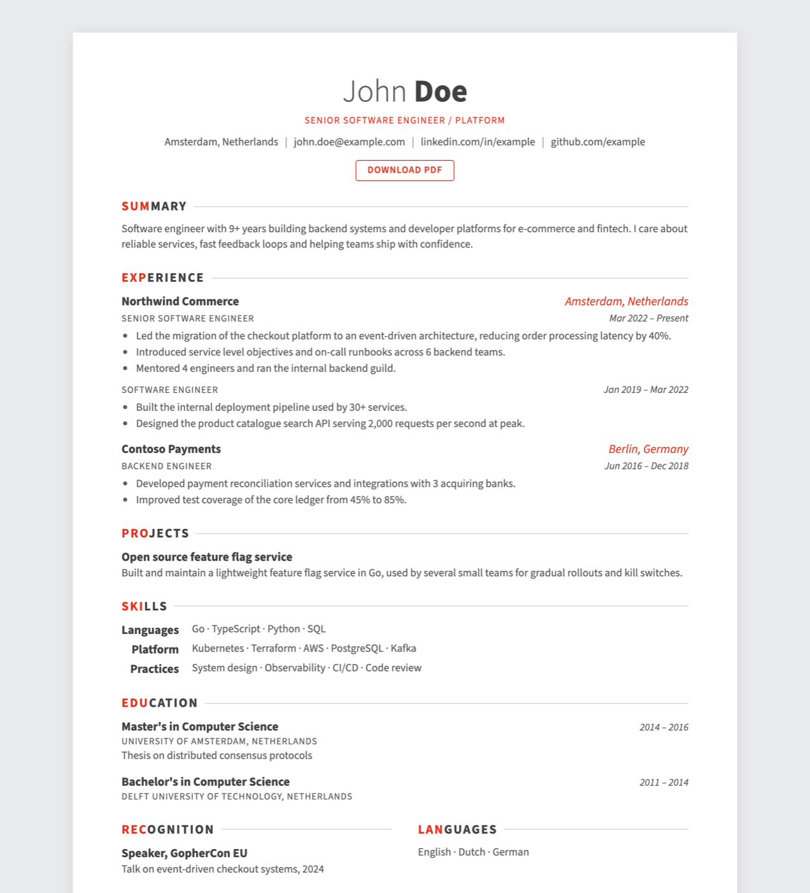

# Astro Awesome CV

An [Astro](https://astro.build/) theme for your CV, inspired by the LaTeX template [Awesome-CV](https://github.com/posquit0/Awesome-CV). Write your CV in 1 YAML file and get a static website plus a print-ready A4 PDF, without LaTeX.

**Demo:** [astro-awesome-cv.sek4.com](https://astro-awesome-cv.sek4.com) · [PDF](https://astro-awesome-cv.sek4.com/cv.pdf)

[](https://app.netlify.com/start/deploy?repository=https://github.com/sht/astro-awesome-cv)

[](https://astro-awesome-cv.sek4.com)

## Features

- All content in `src/data/cv.yaml`, validated at build time so a typo fails the build instead of silently disappearing
- PDF generated at build time with Playwright, using the same HTML and print styles as the website
- Zero client-side JavaScript
- Responsive layout, with print styles for A4 and a page-numbered footer
- Configurable accent color
- Self-hosted Source Sans 3 font

## Getting Started

Requires Node.js 22.12 or later.

```bash
npm create astro@latest -- --template sht/astro-awesome-cv
cd <your-project>
npm run dev
```

You can also click **Use this template** on GitHub, or clone the repo and run `npm ci`.

Open `http://localhost:4321` and edit `src/data/cv.yaml`. The page reloads as you type.

## Customizing

| What | Where |
|---|---|
| CV content | `src/data/cv.yaml` |
| Accent color | `accent` in `src/data/cv.yaml` |
| Demo banner (remove for your CV) | `demo` in `src/data/cv.yaml` |
| Site URL (canonical and Open Graph) | `site` in `astro.config.mjs` |
| Layout and sections | `src/pages/index.astro` |
| Screen and print styles | `src/styles/global.css` |
| Favicon | `public/favicon.svg` |

The schema for `cv.yaml` lives in `src/types.ts`. If you add a field, add it there too.

### Accent colors

The Awesome-CV presets:

| Name | Value |
|---|---|
| Red (Awesome-CV default) | `#dc3522` |
| Sky blue | `#0395de` |
| Emerald | `#00a388` |
| Pink | `#ef4089` |
| Orange | `#ff6138` |
| Nephritis | `#27ae60` |
| Concrete | `#95a5a6` |
| Dark night | `#131a28` |

## PDF

`npm run build` builds the site to `dist/`, then `scripts/build-pdf.mjs` opens it in headless Chromium and saves `dist/cv.pdf`. The "Download PDF" button saves it as `<your-name>-cv.pdf`.

The PDF only exists after a build, so the button returns 404 under `npm run dev`. To check the PDF locally:

```bash
npm run build && npm run preview
```

Chromium is installed by the `postinstall` script.

## Deploy

**Netlify:** use the button above, or import the repo. `netlify.toml` already sets the build command, Node version and publish directory.

**Other hosts:** use `npm run build` as the build command and `dist` as the output directory. The host must be able to run Playwright's Chromium during the build.

## Credits

Design inspired by [Awesome-CV](https://github.com/posquit0/Awesome-CV) by Claud D. Park.

## License

[MIT](LICENSE)
